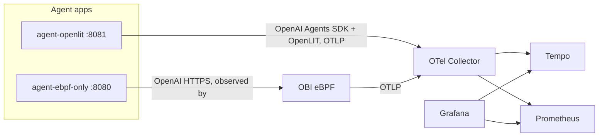

# What did the agent do? — KubeCon Mumbai 2026 Demo

Observability and accountability demo for AI agents using **OpenTelemetry eBPF Instrumentation (OBI)** and **OpenLIT**, with **Grafana**, **Tempo**, and **Prometheus**.

The same research agent (3 tools, multi-step) runs two ways so you can compare **zero-code eBPF** observability against **SDK** observability.

## Talk narrative

| App | URL | Instrumentation | What you see in Grafana/Tempo |
|-----|-----|-----------------|-------------------------------|
| **Zero-code agent** | http://localhost:8080 | **OBI eBPF only** — raw OpenAI SDK, no instrumentation in the app | `chat.completion gpt-4o-mini` GenAI spans (model, tokens, full chat messages) reconstructed off the wire |
| **SDK agent** | http://localhost:8081 | **OpenAI Agents SDK** auto-instrumented by **OpenLIT** | `create_agent` + per-turn `chat` LLM spans with agent/tool context, exported via OTLP |

**Grafana:** http://localhost:3000 (admin / admin)  
**Prometheus:** http://localhost:9090  
**Tempo:** http://localhost:3200

## Quick start (Docker Compose — recommended)

**Requirements:** Linux with Docker (kernel 5.8+ for eBPF). Docker Desktop on Mac/Windows runs a Linux VM — eBPF works there, not on the macOS host directly.

```bash
cp .env.example .env
# Edit .env and set OPENAI_API_KEY

chmod +x scripts/*.sh
./scripts/start.sh
```

Chat with both agents, then open Grafana → **Explore → Tempo** and filter traces by `service.name`:

- `agent-ebpf-only` — zero-code GenAI spans from OBI
- `agent-openlit` — agent + LLM spans from the OpenAI Agents SDK (via OpenLIT)

### Demo flow (5 minutes)

1. Open **8080** — ask *“Search the knowledge base for OBI and summarize.”*
2. In Grafana/Tempo, inspect the `chat.completion` GenAI span (zero code changes in the app).
3. Open **8081** — same question; compare the `create_agent` / `chat` agent spans from OpenLIT.
4. Discuss accountability: tool calls in UI + traces = *what the agent actually did*.

### Troubleshooting

**OBI not tracing `agent-ebpf-only`?**

Startup order is handled by Compose: collector → agents (healthy) → **OBI starts last** so it attaches to the live agent process immediately. `scripts/start.sh` then waits and confirms attachment. Prefer `./scripts/start.sh` over raw `docker compose up`.

OBI only targets **`:8080`** (the OpenLIT app on `:8081` is traced by its SDK, not OBI). Verify attachment:

```bash
docker compose logs obi | grep instrumenting   # expect service=agent-ebpf-only
```

If it isn't attached, restart OBI (it re-discovers the running agent):

```bash
docker compose restart obi
```

**No traces in Grafana?**

1. Verify the collector is healthy (not crash-looping):
   ```bash
   docker compose ps otel-collector
   docker compose logs otel-collector --tail 20
   ```
   On **arm64 Mac**, `otel-collector-contrib:0.116.0` fails to start — this repo pins `0.115.1`.

2. Set Grafana time range to **Last 15 minutes** after you send chat prompts.

3. In Tempo Explore, use TraceQL:
   `{ resource.service.name = "agent-ebpf-only" }`
   or search span name: `POST /v1/chat/completions`

**No “genai” metrics?**

OBI exports GenAI calls as **HTTP client metrics**, not always `gen_ai.*` names. In Prometheus Explore:
```promql
http_client_request_duration_seconds_count{http_route="/v1/chat/completions"}
```

**Only HTTP spans (`POST /v1/chat/completions`) instead of chat spans?**

OBI needs **GenAI payload extraction** turned on. This is the only OBI-specific config the demo requires (`config/obi-config.yaml`):

```yaml
ebpf:
  buffer_sizes:
    http: 65536          # GenAI bodies are large; default buffer truncates them
  payload_extraction:
    http:
      genai:
        openai:
          enabled: true
attributes:
  select:
    traces:
      include:           # opt-in to attach the (large) chat payload attributes
        - gen_ai.input.messages
        - gen_ai.output.messages
        - gen_ai.system_instructions
        - gen_ai.tool.definitions
```

GenAI is not in OBI's default trace instrumentation set, so the exporters also list it explicitly: `instrumentations: ["genai", "http"]`.

You should then see spans named **`chat.completion gpt-4o-mini`** with `gen_ai.*` attributes (model, tokens, messages).

## Architecture



## Offline / conference Wi‑Fi

```bash
./scripts/pull-images.sh      # on good network
./scripts/export-images.sh    # saves to images/*.tar
# copy repo + images/ to demo laptop
./scripts/import-images.sh
./scripts/start.sh
```

## Configuration

| File | Purpose |
|------|---------|
| `config/obi-config.yaml` | OBI discovery (`:8080`) + **GenAI payload extraction** (`ebpf.payload_extraction.http.genai`) |
| `config/otel-collector.yaml` | OTLP → Tempo + Prometheus |
| `apps/common/agent.py` | Shared research agent on the **raw OpenAI SDK** — used by `agent-ebpf-only` so OBI observes it zero-code |
| `apps/openlit-enabled/agent_sdk.py` | Same agent rebuilt on the **OpenAI Agents SDK**, auto-instrumented by `openlit.init()` |

## How OBI sees the agent (zero code)

OBI runs as a sidecar container with `pid: host` + `privileged` (per the [OBI Docker docs](https://opentelemetry.io/docs/zero-code/obi/setup/docker/)). It discovers the agent by its open port (`8080`), hooks the TLS read/write paths via eBPF, and reconstructs the OpenAI `chat/completions` request/response into GenAI semantic-convention spans — no SDK or code change in the app.

## References

- [OpenTelemetry eBPF Instrumentation (OBI)](https://github.com/open-telemetry/opentelemetry-ebpf-instrumentation)
- [OBI Docker setup](https://opentelemetry.io/docs/zero-code/obi/setup/docker/)
- [OpenLIT — Monitor OpenAI Agents](https://docs.openlit.io/latest/sdk/integrations/openai-agents)

## License

Apache-2.0
